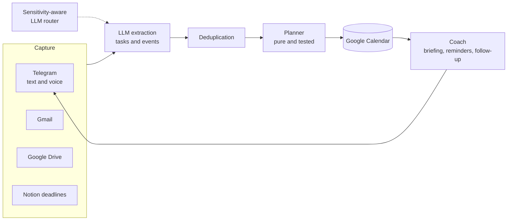

# Second Brain

*[English version](README.md)*

   

Un « second cerveau » personnel qui vit dans Telegram. Il lit mes mails, mes documents et mes notes vocales, répond à mes questions en citant ses sources et, surtout, **transforme mes tâches en blocs d'agenda et me relance jusqu'à ce qu'elles soient faites**.

Conçu pour tourner gratuitement sur une petite VM toujours allumée (API gratuites, 1 Go de RAM).

## Architecture en un coup d'œil



## Points forts techniques

- **Un planificateur pur et très testé.** `coach/planner.py` ne fait aucune E/S ; les invariants (pas de chevauchement, heures autorisées, plafond quotidien, échéances) sont vérifiés dans plus de 570 tests.
- **Confidentialité par construction.** Chaque élément a un niveau de sensibilité, et le routeur LLM refuse d'envoyer du contenu `private` à un modèle cloud.
- **Jamais de doublon d'événement.** Les identifiants d'événements d'agenda sont calculés de façon déterministe et chaque tâche ou rendez-vous entrant est comparé à l'existant (mails, notes, Notion, agenda).
- **Tombe visiblement, repart seul.** Un jeton Google révoqué ne fait plus boucler le bot en redémarrages : les services sont construits à la demande, les jobs en échec déclenchent une alerte, et tout reprend dès que le jeton est remplacé.
- **Tourne sur une VM gratuite de 1 Go** sous plafond mémoire systemd, avec des quotas d'API gratuits que le bot suit lui-même.

## Ce qu'il fait

| Domaine | Fonctions |
| --- | --- |
| **Capture** | Notes texte et vocales sur Telegram, Gmail (lecture seule), documents Google Drive (PDF…) rangés automatiquement |
| **Extraction** | Un LLM transforme un texte en *tâches* (échéance, durée estimée, priorité) et en *événements* (date/heure fixes). Les doublons sont détectés entre mails, notes, Notion et agenda |
| **Planification** | Un planificateur pur et testé place chaque tâche dans Google Agenda, dans les heures autorisées, autour des créneaux bloqués et des événements existants. Une tâche ne démarre jamais « trop tôt » pour sa taille (5 min : le jour même ; gros dossier : plusieurs jours avant) |
| **Coaching** | Briefing du matin, rappel avant chaque bloc, suivi après (fait / pas fini / reporter), récap de la semaine, classement quotidien du « focus » avec la raison de chaque priorité |
| **Projets** | `/projet` m'interroge pour définir un projet, le découpe en étapes, propose les tâches suivantes et prévient quand un projet stagne ou qu'un rendu approche |
| **Mémoire** | `/ask` répond à partir de mes notes, mails et documents (recherche SQLite FTS5) en citant la source |
| **Intégrations** | Base d'échéances Notion (dans les deux sens), journal Google Docs, suivi des quotas gratuits, alertes de panne |

## Routage des modèles selon la confidentialité

Chaque élément stocké porte une `sensitivity` (`private` ou `public`). Le contenu `private` n'est **jamais** envoyé à un modèle cloud : le routeur (LiteLLM) refuse. Le contenu public part vers Groq (principal) avec Gemini en secours ; un modèle Ollama local peut servir le contenu privé sur une machine assez puissante.

## Architecture

```
run.py                  point d'entrée : bot Telegram + planificateur + jobs Gmail/Drive/Notion
bot/                    couche Telegram (handlers, ports, transcription vocale)
coach/                  logique métier : planificateur, scheduler, extraction, focus, projets, dédoublonnage, SQLite
llm_router/             enveloppe LiteLLM : routage par sensibilité, secours, délais, suivi d'usage
drive_sync.py ...       intégrations Google Drive / Gmail / Notion / journal
scripts/                utilitaires ponctuels (réautorisation Google)
deploy/                 exemple d'unité systemd
tests/                  570+ tests (planificateur, extraction, scheduler, bot, intégrations)
```

Le planificateur (`coach/planner.py`) est pur — ni réseau ni E/S — ce qui rend son comportement facile à tester. Les règles (heures autorisées, créneaux bloqués, marges, délai de démarrage selon la taille d'une tâche) sont dans [`coach/rules.yaml`](coach/rules.yaml).

## Démarrage

Prérequis : Python 3.12+, un jeton de bot Telegram, un client OAuth Google Cloud (Gmail, Agenda, Drive, Docs) et au moins une clé d'API LLM (Groq et/ou Gemini).

```bash
python -m venv .venv && source .venv/bin/activate
pip install -r requirements-server.txt        # exécution
pip install -r requirements-dev.txt           # + pytest

cp .env.example .env                          # renseigner les clés
mkdir secrets && cp /chemin/vers/client_secret.json secrets/
python -m scripts.reauth_google               # ouvre un navigateur, écrit secrets/token.json

python run.py                                 # --no-gmail pour ne pas lire les mails
pytest                                        # lancer les tests
```

`secrets/`, `.env` et `data/` sont ignorés par git : à conserver ainsi.

## Déploiement

Il tourne comme service systemd sur une petite VM Linux — voir [`deploy/second-brain.service`](deploy/second-brain.service). À lancer depuis **une seule** machine : deux instances avec le même jeton Telegram se gênent, et deux bases créeraient des événements d'agenda en double.

## Technologies

Python · python-telegram-bot · APScheduler · SQLite (FTS5) · Pydantic · LiteLLM (Groq, Gemini, Ollama) · API Google (Gmail, Agenda, Drive, Docs) · API Notion · pytest
